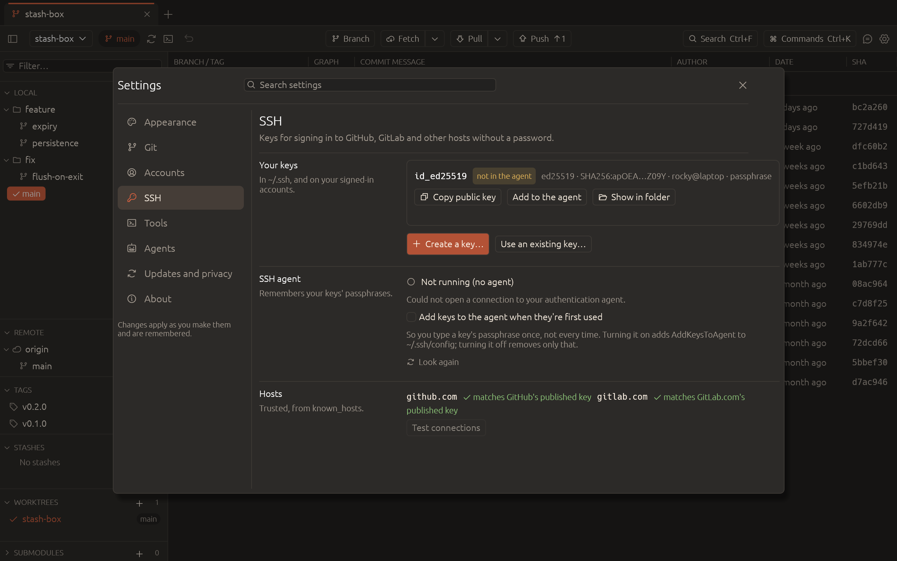
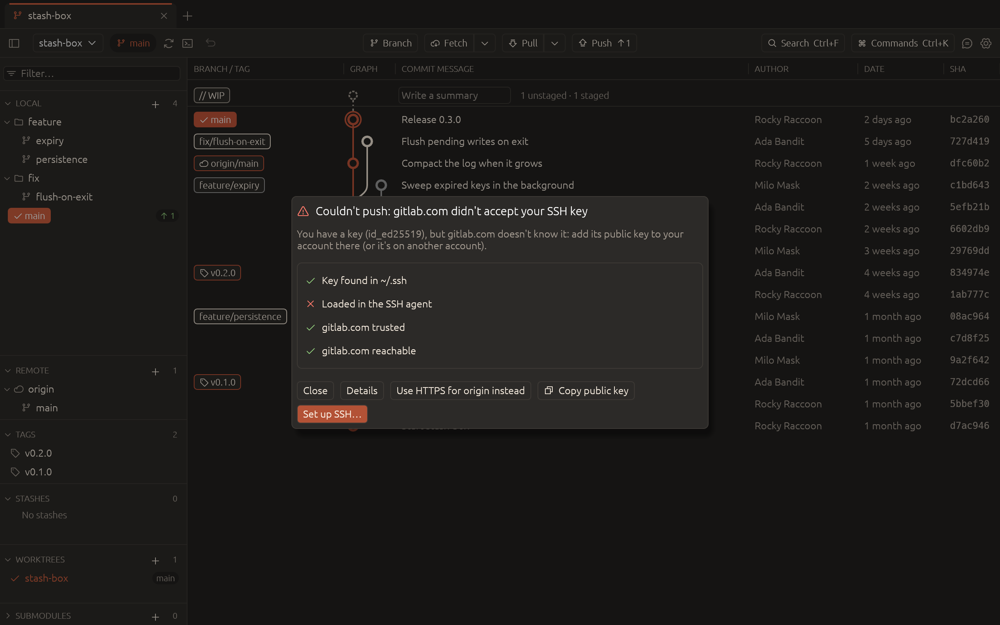

# Git Raccoon user guide

Git Raccoon shows your project's history as a graph, and lets you do everyday Git work with buttons, menus and drag and drop. It runs your own `git` underneath, so your hooks, signing, SSH keys and credential helpers work just as they do on the command line.

- [Quick start](#quick-start)
- [Installing](#installing)
- [Opening a repository](#opening-a-repository)
- [The window](#the-window)
- [Committing](#committing)
- [Branches and tags](#branches-and-tags)
- [Syncing with a remote](#syncing-with-a-remote)
- [Pull requests, merge requests and issues](#pull-requests-merge-requests-and-issues)
- [Merging, rebasing and conflicts](#merging-rebasing-and-conflicts)
- [Rewriting history](#rewriting-history)
- [Looking back: file history and blame](#looking-back-file-history-and-blame)
- [Undo](#undo)
- [Tabs, submodules and worktrees](#tabs-submodules-and-worktrees)
- [AI agents](#ai-agents)
- [Keyboard and the command palette](#keyboard-and-the-command-palette)
- [Themes and settings](#themes-and-settings)
- [Updates, feedback and crash reports](#updates-feedback-and-crash-reports)
- [Troubleshooting](#troubleshooting)

## Quick start

1. **Open a repository** from the welcome screen, or clone one.
2. **Click the `// WIP` row** at the top of the graph to see your changes.
3. **Stage** files, write a summary, and press **Commit** (Ctrl+Enter).
4. **Push** from the toolbar.

Made a mistake? **Ctrl+Z** undoes most things. Can't find something? **Ctrl+K** opens the command palette, where every action is a few letters away.

## Installing

Download the installer for your system from the [releases page](https://github.com/Trashpanda-GameDev/Git-Raccoon/releases). Git Raccoon needs [Git](https://git-scm.com) installed.

| System | Download | First run |
| --- | --- | --- |
| Windows | `GitRaccoon-win-Setup.exe` | If Windows warns about an unknown publisher: *More info* › *Run anyway*. |
| macOS (Apple Silicon) | the `.pkg` installer | Right-click Git Raccoon in Applications › *Open* (or allow it in *System Settings › Privacy & Security*). |
| Linux | the `.AppImage` | Make it executable (`chmod +x`) and run it. |

On Windows, it installs just for you (no administrator needed), into any folder you choose, and uninstalls from *Settings › Apps*. Once installed, it [keeps itself up to date](#updates-feedback-and-crash-reports).

## Opening a repository

The welcome screen offers:

- **Open a repository…**: pick its folder (or any folder inside it).
- **Clone a repository…**: paste a URL, or pick one of your repositories from a signed-in GitHub or GitLab account.
- **New repository…**: made on this computer, or on GitHub or GitLab too.
- **Recent** repositories, one click away.

Your open repositories come back the next time you start Git Raccoon.

### Cloning options

- **Shallow clone**: only the latest commit, not the history before it.
- **Sparse checkout**: only the folders you name (and the files at the top).

A progress bar shows while it clones, with a Cancel button.

### New repository options

Give it a name, a folder and its first branch's name. You can also add:

- a **.gitignore template** and a **License**;
- **Git LFS**, for large files;
- on GitHub or GitLab: a description, **Public** or **Private**, and whether to clone it here.

The extras go in a first commit, which is pushed when the repository is made on a forge.

## The window

| Part | What it shows |
| --- | --- |
| **Sidebar** (left) | Branches, remotes, tags, stashes, worktrees, submodules, and pull requests and issues. |
| **Graph** (middle) | Every commit, newest first, with branch lines and labels. |
| **Details pane** (right) | The selected commit, or your working changes. |
| **Toolbar** (top) | Repositories, the current branch, Branch, Fetch, Pull, Push, Undo, search, the command palette and settings. |

### The graph

- **Click** a commit to see it. **Double-click** a branch label to check it out.
- **Right-click** a label or commit for everything you can do with it.
- A **cloud** after a branch name means the remote's copy is at the same commit.
- **"main +2"** means more labels: point at it to see them all.
- When there are many branches side by side, the graph scrolls sideways (Shift+wheel, or the bar under *Graph*).

Moving around:

| Keys | Go to |
| --- | --- |
| ↑ / ↓, Page Up / Down | The next commits |
| Shift+↓ / Shift+↑ | Along the selected commit's branch |
| Ctrl+↓ / Ctrl+↑ | The next commit with a label |
| Home / End | The newest / oldest commit |
| Ctrl+H | The checked-out commit |

### The sidebar

- **Click** an item to jump to its commit. The **filter** box at the top narrows the lists.
- **Click a heading** to collapse its section; **drag the line** between sections to resize them.
- **Right-click a heading** to hide sections you don't use (also in Settings › Appearance › Sidebar).
- **Right-click a local branch › Pin to top** to keep it at the top of *Local* (pinned branches are listed by name, with a pin); *Unpin* puts it back.

### Columns and panes

- **Drag** the edge of the sidebar or details pane to resize it.
- **Drag a column heading** (Graph, Commit message, Author…) to move it; drag its edge to resize, or double-click the edge to fit.
- **Right-click a heading** to put the columns back as they were.

### Diffs

Click a file to see its diff. Switch between:

- **Unified** or **Split** (side by side: drag the line between the sides to give one more room, double-click it for half each);
- **Changes** (with a few lines around them) or **Whole file**.

Diffs have syntax highlighting, the changed words marked, and image previews. Long lines scroll sideways.

### Search

**Ctrl+F** finds commits by message, author or SHA, or by the files they touch (the file button). **Enter** and **Shift+Enter** go through the matches; **Esc** closes it.

## Committing

When you have changes, a **`// WIP`** row sits at the top of the graph. Click it to see them in the details pane.

1. **Stage** what you want to commit: a file's button, or pick several (Ctrl+click, Shift+click) and right-click.
2. Write a **summary** (it turns amber past 50 characters, red past 72) and, if you like, a description.
3. **Commit**, or press Ctrl+Enter.

You can also type the summary straight into the `// WIP` row.

### Staging parts of a file

Open a file's diff, then:

- **A hunk:** its **Stage hunk** button.
- **Some lines:** click a line, Shift+click or drag for a range, Ctrl+click to add one, then right-click › **Stage selection**.

Right-click › **Copy** (or Ctrl+C) copies the picked lines. **Esc** lets go of them.

### Other things you can do

- **Amend last commit**: replace the last commit (it warns if that one is already pushed).
- **Stash**: put your changes aside. When some are staged, only those go. Right-click a stash (sidebar or graph) to apply, pop or delete it.
- **Discard**: throw changes away. Discarded files go to the Recycle Bin or Trash, so they can be recovered.
- **Ignore**: right-click new files to add them to `.gitignore`.
- **Folder view**: the tree button shows files in their folders instead of by path.

The unstaged and staged lists share the pane: drag the line between them, or click a heading to fold one away.

Your hooks run as usual. If one refuses the commit, its message is shown and your commit message is kept.

## Branches and tags

Right-click a branch, in the sidebar or on the graph:

- **Check out** (or double-click it)
- **Create branch here**, **Rename**, **Set upstream**
- **Merge into…**, **Rebase onto…**
- **Open a pull request…** (when signed in to its forge)
- **Delete…**

The **+** next to *Local* makes a new branch. Right-click a commit to make a branch or tag there, or to check that commit out. Tags can be lightweight, or annotated with a message.

### Deleting

**Delete…** asks where, with a checkbox for each place: *Local*, and each remote that has it.

- If a branch has commits that aren't anywhere else, it asks again first.
- **Undo** puts it back wherever it was deleted, remotes included.

To delete **several branches**, Ctrl+click (Cmd+click on a Mac) or Shift+click them in the sidebar, then right-click.

> **Your work is protected.** If uncommitted changes are in the way of a checkout, Git Raccoon offers to stash them first.

## Syncing with a remote

| Button | What it does |
| --- | --- |
| **Fetch** | Gets new commits from every remote, without changing your branches. |
| **Pull** | Brings the upstream's new commits into your branch. |
| **Push** | Sends your commits. |

Progress shows in the toolbar, with a Cancel button. The **arrow** beside each button picks another remote, and sets its options (remembered).

### Fetch

Git Raccoon also **fetches on its own** every 10 minutes. Change that in Settings › Git (1 to 60 minutes, or 0 for never). It never asks for a password then: a remote that needs one is left for you.

Options in the arrow menu:

- **Prune** (on to start with): removes remote branches deleted there.
- **Force**: lets fetched refs overwrite local ones, even where that loses commits. It asks first.

### Pull

By default, Pull only **fast-forwards**. If both sides have new commits, it asks whether to **merge** or **rebase**. Your uncommitted changes are put aside and back.

Options in the arrow menu:

- **When both sides have new commits:** fast-forward only (and ask), fast-forward or else merge, or rebase.
- **Your uncommitted changes:** put aside and back, left as they are (Git may refuse), or discarded (it asks first).

### Push

- **A new branch:** a bar asks where it goes (the same name on `origin`, to start with). From then on it pushes and pulls there.
- **The remote has commits you don't:** it offers to pull first, or to **force push**. Force pushes are always *with lease*, so they never delete commits you haven't seen.

### Remotes and remote branches

- **+** next to *Remote* adds one (and fetches it). Right-click one to edit or remove it.
- Right-click a remote branch › **Delete…** deletes it on the remote, for everyone (Undo puts it back).

### Passwords and keys

Git Raccoon uses your existing Git setup: Git Credential Manager, other credential helpers, and your SSH agent. When Git needs a password, passphrase or a new host confirmed, it asks in a dialog. If you're [signed in to the forge](#signing-in), that account answers for you. For SSH, see [SSH](#ssh).

## SSH

SSH lets Git sign in to GitHub, GitLab and other hosts with a key on your computer instead of a password. Git Raccoon runs your own `ssh` and keeps your own setup: your `~/.ssh/config`, your agent and your `core.sshCommand` always win, and nothing outside `~/.ssh` and your repository's remotes is changed, and nothing without saying so first.

### Setting it up

**Set up SSH for GitHub/GitLab** does everything in one window, for an account you're [signed in to](#signing-in): a key (one you have, or a new one), remembered by the agent, added to your account, a connection test, and (from a repository) its remote switched to SSH. Steps already done are ticked and skipped; each says what it changes first, and each can be done by hand instead (*Copy it and add it myself*, then *Check again*). Open it from **Settings › SSH**, the clone dialog, a remote's menu (*Set up SSH…*), or an SSH error.

### Settings › SSH

- **Your keys** in `~/.ssh` (and those your `~/.ssh/config` names), each with its type, fingerprint and comment, whether it's **in the agent**, and on which of your accounts. *Copy public key*, *Add to the agent* (its passphrase is asked in the app), *Add to GitHub/GitLab*, *Show in folder*.
- **Create a key…** makes an ed25519 key in `~/.ssh` (with a passphrase, or none after a warning), never replacing one, and can add a `~/.ssh/config` entry for a host, shown first. **Use an existing key…** adds one from elsewhere to the agent, or uses it for a host.
- **The agent**: which one (OpenSSH's, macOS's, 1Password, GnuPG's, Windows'), whether it's running, and **Add keys to the agent when they're first used**, so you type a passphrase once (it adds `AddKeysToAgent` to `~/.ssh/config`; turning it off removes only that).
- **Hosts** SSH trusts (from `known_hosts`), marked when they match the keys GitHub and GitLab.com publish, and **Test connections** to your accounts' hosts ("Signed in to github.com as rocky.", or exactly why not).

To add keys to an account, GitHub needs a sign-in that may manage SSH keys: signing in now asks for that, and an older sign-in is offered a fresh one when it's needed.

### Trusting a host

The first time SSH connects to a host, it asks whether to trust its key. Git Raccoon checks it against the keys the host publishes: "This is GitHub's published key", or a red warning when it isn't one (someone may be between you and the host: cancel, and try another network). For hosts that don't publish their keys where the app can check, compare the fingerprint with what whoever runs it says.

When a host's key has **changed** since you trusted it, SSH refuses to connect. *Test connections* says what that can mean, checks the new key, and offers to replace the old one only when the new one is the published one.

### When SSH fails

When a fetch, pull or push fails over SSH, Git Raccoon tests the connection and checks your keys, the agent and your account, then says what's wrong, with the checks it made, and offers the fix: *Add the key to GitHub and retry*, *Add it to the agent and retry*, *Check the host's key and retry*, *Use port 443* (GitHub, when a firewall blocks SSH's usual port), *Use HTTPS for origin instead*, or *Set up SSH…*. A background fetch that fails this way only says so in Fetch's tip.

### SSH or HTTPS

- **Cloning** one of your repositories offers *Connect with SSH / HTTPS*, choosing SSH when your key already works with that forge.
- **A remote's menu** (right-click it in the sidebar) has *Use SSH instead* or *Use HTTPS instead*, *Use port 443* for GitHub, and *Test connection*. A changed address shows both first, and **Undo** puts it back.

### On Windows

Windows has two SSH setups: Git for Windows' own `ssh`, and Windows' OpenSSH with its agent service. Git uses its own, which can't see keys loaded in Windows' agent (so it asks for the passphrase every time). When your keys are in Windows' agent, Git Raccoon's own Git uses Windows' `ssh`; Settings › SSH says so, and offers **Use it for Git everywhere too** (which sets `core.sshCommand`). When Windows' agent service is turned off, it shows the PowerShell line that turns it on (as an administrator).

## Pull requests, merge requests and issues

For a repository on **GitHub**, **GitLab.com** or a **self-managed GitLab**, the sidebar lists its open pull requests (merge requests on GitLab) and issues, newest first. When there are more than 50, **Load more** at the end of the list shows the next ones.

### Signing in

1. Open **Settings › Accounts › Add account…** (or *Sign in* in the sidebar).
2. Pick GitHub, GitLab.com or Self-managed GitLab (with its address).
3. Approve the code in your browser. Or choose **Use a token instead**, and **Make a token…** opens the page to create one.

You can be signed in to several forges at once. Tokens are kept in your system's keychain, never in the settings file.

> **Self-managed GitLab with the browser** needs Git Raccoon registered once on the server (GitLab 17.2 or later): choose *Use the browser instead* › **Make an app…**, untick *Confidential*, tick `api`, and paste its **Application ID** back in.

### A request's view

Click a request to open it in place of the graph. **Esc** goes back.

The header shows its state, branches, checks, approvals and unresolved threads. Below it are three tabs:

- **Conversation**: the description and comments (as formatted Markdown, images included), reviews, checks, and threads with the code they're about.
- **Commits**: **Show them in the graph** marks them there (a bar takes you back). Click one to go straight to it.
- **Changes**: each file's diff, with comment threads under their lines. **Reply**, **Resolve** or **Unresolve** them there. The arrows by the file's name (or **Alt+↑** / **Alt+↓**) go to the previous or next thread, across files. Switch to **Split**, **Whole file** or **Blame**, as in any diff (Git Raccoon fetches the request's commits in the background for these, without making a branch).

### Reviewing

Your comments are **drafts** until you finish the review, then they're all sent at once.

- **On a line:** the **+** beside it, or right-click › *Comment on this line*.
- **On several lines:** pick them (click, Shift+click or drag), then right-click › *Comment on selection*.
- **Replies** and **comments on the whole request** are drafts too.

When you're done, press **Finish review**: add a summary if you like, choose **Comment**, **Approve** or **Request changes**, and send. (GitLab can't *request changes* through its API.)

Drafts can be edited or deleted. They're kept on GitHub (in your pending review) or GitLab (as draft notes) as you write them, so they're there on the website or another computer too, and drafts started there show up here. Comments on the whole request stay on your computer until you finish, as GitHub can't hold them in a review.

Your own posted comments have a pencil (edit) and a bin (delete) beside them.

### Suggested changes

A suggestion shows the lines it would change and what they'd become.

- **On GitLab:** **Apply** commits it to the request's branch. Tick *Apply with others* to apply several in one commit.
- **On GitHub:** **Apply here** changes the file on the request's branch, once it's checked out. You commit and push it.

To suggest one yourself, pick lines in Changes and right-click › **Suggest a change**.

### Merging

**Merge** offers the methods the repository allows (merge commit, squash, rebase, or fast-forward on GitLab), the commit message, and *Delete the branch after merging*. If it can't be merged yet, it says why. When it's behind its target, **Update branch** (GitHub) or **Rebase onto…** (GitLab) brings it up to date.

### Checking out

**Check out ▾** puts you on the request's branch, or in a **new worktree** beside this folder, which opens in a tab. A request from a fork gets a branch of its own (`pr/12` or `mr/12`), which follows the request, so Pull brings its new commits.

- **Uncommitted changes in the way?** It asks: put them aside and check out, use a worktree instead, or cancel.
- **On its branch,** the header offers **Pull the latest** and **Back to…** the branch you were on. Changes put aside come back with you.

### Opening a new request

Use the **+** next to *Pull requests*, or right-click any local branch › **Open a pull request…**. It opens in place of the graph, like a request, with **Description**, **Commits** and **Changes** tabs; Esc cancels.

- Pick the branch it goes into. The window shows its commits and the files it changes (click one for its diff), and warns if it won't merge cleanly.
- The title and description are filled in from its commits, or from the repository's template.
- Pick **reviewers**, **assignees** and **labels** from the project's own.
- Not pushed yet? **Push and open** does both, even for a branch that isn't checked out.

After you push a new branch, a bar offers to open a request for it.

### Opening pages on the forge

Right-click a commit, branch, remote, tag, request or issue › **Open on GitHub/GitLab**, or copy its link.

**Issues** open in the details pane. The lists reload when you fetch or refresh.

## Merging, rebasing and conflicts

- **Merge:** right-click a branch › *Merge into…*, or **drag** it onto another branch (in the sidebar or on the graph).
- **Rebase:** right-click a branch › *Rebase onto…*. It warns if your commits are already pushed.
- **Before you start**, the question says whether it would conflict, and in which files ("This will conflict in 2 files: …"), or that it goes in cleanly. This is worked out without touching your files. A pull that merges or rebases asks first only when, as of your last fetch, it would conflict.

### Conflicts

If changes conflict, the conflicts take the place of the history:

- **The bar at the top** says what's going on ("Rebasing feature/login onto main · commit 3 of 5: *Remember the last user*"), with **Continue** (once nothing's left), **Abort**, **Skip this commit** (rebases), and **Show history** to look at the graph meanwhile.
- **Every file** is listed with how it conflicts: **Resolve…** opens one (or **Next conflict**); a file deleted on one side and changed on the other is settled with **Keep main's** or **Delete it**.
- **Resolved files** stay in the list: **Review** shows the result, **Undo** brings the conflict back.

Sides are named by their branch (*main*, *feature/login*), not "ours" and "theirs", which swap meaning between a merge and a rebase.

In a file, each conflict shows three versions side by side: **Before** (what both sides started from) and each side's, with the commit that changed it. To resolve it:

- **Take main** or **Take feature/login** for one side, or **Both ▾** in either order;
- or tick the lines you want from any of the three (they go into the result in the order you tick them), and touch up the **Result** below them, then **Use this result**;
- or **Edit** the whole file yourself, or take one side's **Whole file**.

**Ctrl+↑ / Ctrl+↓** move between conflicts. When none are left, **Mark resolved**.

**Panes** (the two-column button in the editor's header; the one beside it goes back to cards) show the file another way, taking the whole window (the side panels come back when you close it): each side's whole file next to each other, with the commit it's from, and below them the **Output**, the file as it will be saved. Tick a conflict with the box on its first line, or click single lines; the box in a side's header takes that side in every conflict. The output's bar says which conflict you're on, with ▲ ▼ to move. **Save** writes every conflict you chose; the ones you didn't stay conflicts. Drag the line above the output to give either part more room. The view you used last is remembered.

**Remember how I resolve conflicts** (*Settings › Git › Conflicts*, off to start with) uses Git's own `rerere` for Git Raccoon's Git, leaving your Git config alone. When a conflict you've resolved comes back (often in a long rebase, or merging main again), it's resolved the same way and listed as **resolved as before**: **Review** it, or **Redo by hand** to bring the conflict back. It still needs **Mark resolved**, so nothing goes through unchecked.

**Ask an agent** (when one is connected in Settings › Agents) gives you a request to paste to it. It reads the conflicts and proposes the whole file, with its reasoning; that shows in place of the conflicts, and nothing is written until you choose **Use this** (undoable), **Edit it** first, or **Discard**.

**Why?** shows, above the conflict in focus, the commits on each side that changed its lines (in a rebase, the commit being applied), with their messages, who made them and when, and the pull/merge request they came in with when the message says so. **Show these commits** marks them in the graph (**Back to** the file from there). When it's clear what happened (a rename on one side, lines only added on the other), a hint says so.

## Rewriting history

Right-click a commit in the graph:

| Action | What it does |
| --- | --- |
| **Cherry-pick onto…** | Copies its changes onto your branch. |
| **Revert this commit** | Adds a commit that undoes it. |
| **Reset… to here** | Moves your branch back: *soft* keeps the changes staged, *mixed* keeps them in your files, *hard* discards them. |
| **Interactive rebase from here** | Opens a planner: drag commits to reorder, and **Pick**, **Reword**, **Squash**, **Fixup** or **Drop** each one. |

## Looking back: file history and blame

In any diff, turn on:

- **History**: every commit that changed the file (following renames), down the side. Click one to see its change.
- **Blame**: who last changed each line, and when. Click a commit to go to it. It's most useful with **Whole file**.

They can be on together, and are remembered.

## Undo

After most actions, the toolbar shows exactly what **Undo** would do ("Undo commit 'Fix the thing'"). Press it, or **Ctrl+Z**.

It covers commits, amends, checkouts, merges, rebases, cherry-picks, reverts, resets, branch and tag changes, and stashes. It checks nothing has changed since, so it never throws away newer work.

## Tabs, submodules and worktrees

- **Tabs:** each repository opens in its own tab. Ctrl+T opens one, Ctrl+W closes it, Ctrl+Tab switches. Drag tabs to reorder them.
- **Submodules:** listed in the sidebar. Right-click to open one in a tab, or update it. **+** adds one: give its URL, and the folder to put it in. It's cloned there and staged with `.gitmodules`, ready to commit.
- **Worktrees** (extra working folders of the same repository): **+** adds one; right-click to open or remove it.
- **Git LFS:** repositories using it show an *LFS* badge (amber if git-lfs isn't installed).

## AI agents

Agents such as Claude Code, Claude Desktop or Cursor can work with Git Raccoon through MCP (the Model Context Protocol). It's off unless you turn it on.

1. **Turn it on:** *Settings › Agents › Let AI agents connect.*
2. **Add Git Raccoon to the agent:** the same page has the command (for Claude Code) and the config (for the others), with copy buttons. The agent runs `git-raccoon mcp`, which reaches the app while it's open.

What an agent can do:

- **Read, freely:** the repositories open here, what you're looking at, status, history and search, commits and diffs, branches, tags and stashes, and pull/merge requests with their threads.
- **Show you things:** select a commit, open a request or a repository, or start a new request filled in for you to check and open.
- **Change things, once you allow it:** stage, commit, branches, checkout, stash, tags, merge, fetch, pull and push. Each change asks you: *Allow*, *Allow for this session*, or *Deny*. Discarding changes asks every time. Pushes never force, and pulls never throw changes away.
- **Propose conflict resolutions:** they read the conflicts in progress and propose a file's resolution with their reasoning; you choose whether to use it (see *Conflicts*).
- **Comment on requests, as drafts:** comments and replies go into your drafts; you send them when you finish your review. Resolving a thread asks you first.

A robot in the toolbar shows while an agent is connected. Agents can only connect from this computer, with a key the app keeps beside its settings.

## Keyboard and the command palette

**Ctrl+K** opens the command palette: type a few letters to find any action, or a branch to check out, merge or go to. On macOS, use Cmd for Ctrl.

| Action | Shortcut |
| --- | --- |
| Command palette | Ctrl+K |
| Settings | Ctrl+, |
| Open repository | Ctrl+O |
| New tab / Close tab | Ctrl+T / Ctrl+W |
| Next / previous tab | Ctrl+Tab / Ctrl+Shift+Tab |
| Search commits | Ctrl+F |
| Undo | Ctrl+Z |
| Fetch / Pull / Push | Ctrl+Shift+F / D / U |
| Show working changes | Ctrl+Shift+W |
| Write a commit message | Ctrl+Shift+M |
| Stage all / Unstage all | Ctrl+Shift+S / A |
| Stash | Ctrl+Shift+H |
| New branch / New tag | Ctrl+Shift+B / T |
| Zoom in / out / reset | Ctrl++ / Ctrl+- / Ctrl+0 (or Ctrl+scroll) |
| Refresh | F5 |
| Open a terminal here | Ctrl+` |

Moving around the graph has [keys of its own](#the-graph).

**A terminal** (the toolbar button, or Ctrl+`) opens in the repository's folder, for anything Git Raccoon doesn't do. Choose which terminal in Settings › Tools.

## Themes and settings

**Settings** (the gear, or Ctrl+,) applies changes as you make them. **Search settings** (Ctrl+F) finds any setting, and **Reset to defaults** puts a section back.

| Section | What's there |
| --- | --- |
| **Appearance** | Light, dark or match system; the look; interface size (90–150%); how the graph's lines bend; the sidebar's sections. |
| **Git** | How Pull and Fetch behave; how often to fetch in the background; diff and file list defaults. |
| **Accounts** | Your GitHub and GitLab accounts. |
| **SSH** | Your SSH keys, the agent, trusted hosts, and setting it all up ([SSH](#ssh)). |
| **Tools** | The terminal to open (`{path}` stands for the folder), and where new clones go. |
| **Updates and privacy** | Automatic updates, **Check for updates now**, and clearing recent repositories. |
| **About** | The version, what's new, feedback, and licenses. |

### Your own themes

Under the looks, **New theme** opens the editor:

- Pick a colour for each part (surfaces, text, accent, changes, graph lines), for the dark and the light version.
- The app changes as you edit.
- If text would be hard to read, it says so; **Make it readable** fixes it.

**Export…** saves a theme as a small `.json` file to share; **Import…** adds one.

## Updates, feedback and crash reports

- **Updates:** Git Raccoon checks for a new version at start and every half hour, and downloads it in the background. When it's ready, press **Restart to update**; your tabs and settings are kept. To check now: Settings › Updates and privacy › **Check for updates now**.
- **What's new:** shown after each update (and again from the command palette).
- **Feedback:** the speech-bubble button sends a bug report, feedback or an idea, as a public issue on GitHub. Signed in to GitHub, it's posted as you; otherwise it's posted anonymously, and you can add how to reach you. You can include a screenshot (shown to you first).
- **Crash reports:** if Git Raccoon hits a bug, it writes a report on your computer. Nothing is sent: next time, it shows you the report and lets you choose whether to post it.

## Troubleshooting

| Problem | What to do |
| --- | --- |
| "Git isn't installed, or isn't on PATH." | Install [Git](https://git-scm.com), then restart Git Raccoon. |
| Fetching or pushing asks for a password every time. | Set up a credential helper (Git Credential Manager comes with Git for Windows), or use SSH: *Set up SSH for GitHub/GitLab* in Settings › SSH. |
| SSH asks for the passphrase every time. | Add the key to the agent (Settings › SSH), and turn on *Add keys to the agent when they're first used*. On Windows, see [On Windows](#on-windows). |
| "Permission denied (publickey)" | The SSH error says which part is missing (a key, the agent, your account) and offers the fix. Or test it in Settings › SSH. |
| Port 22 is blocked (at work, say). | For GitHub, *Use port 443* in the SSH error or the remote's menu; otherwise *Use HTTPS instead*. |
| "Password authentication is not supported" (GitHub) | Sign in to GitHub in Settings › Accounts, or use a personal access token as the password. Remove an old saved password from your credential helper. |
| "Not owned by current user" / "dubious ownership" | Git doesn't trust the folder. Its message shows the `git config --global --add safe.directory …` command that fixes it. |
| SSH asks whether to trust a host. | The question checks its key against the one GitHub or GitLab.com publishes; for other hosts, compare the fingerprint with what whoever runs it says. |
| "Remote host identification has changed" | Don't connect until it's checked: *Test connections* in Settings › SSH checks the new key and replaces the old one only when it's the published one. |
| Large files show as small text files. | The repository uses Git LFS: install [git-lfs](https://git-lfs.com) and run `git lfs pull`. |
| Something else went wrong. | The error banner shows Git's own message. If it looks like a bug, please [report it](https://github.com/Trashpanda-GameDev/Git-Raccoon/issues). |
